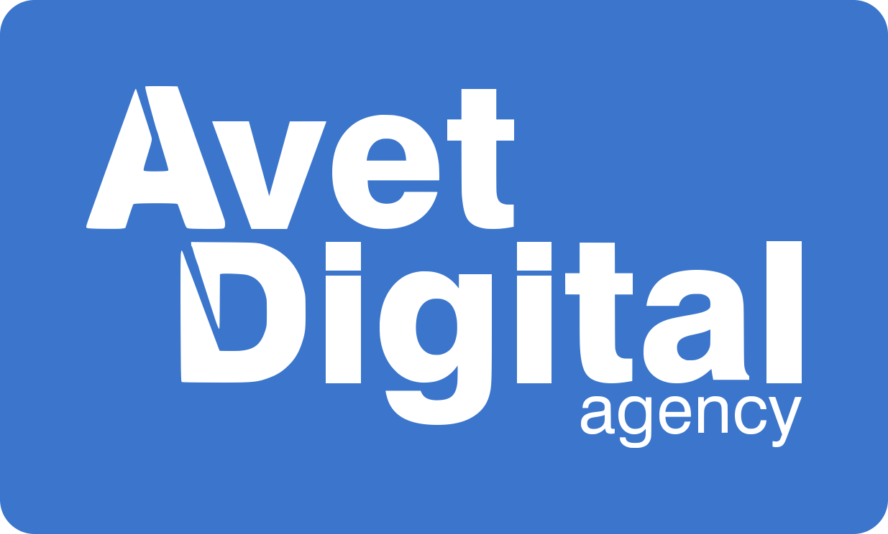
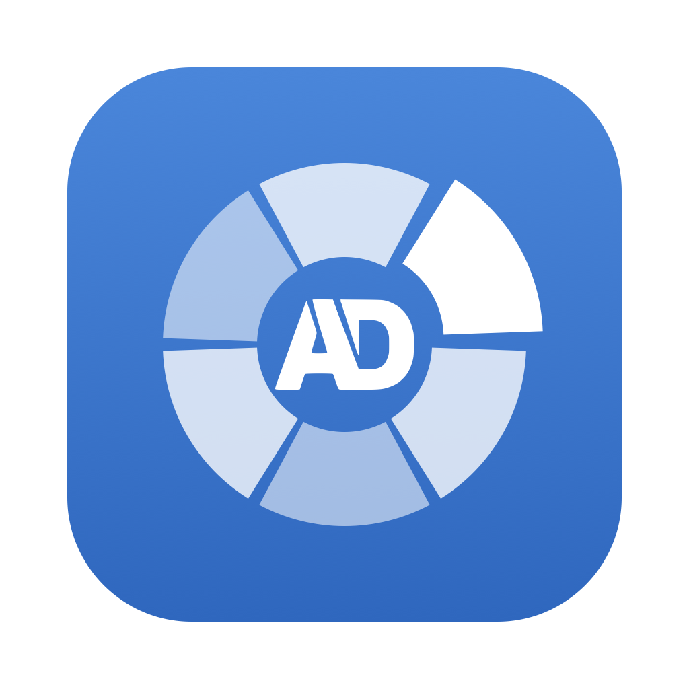

  

<h1 align="center">
   
  Filee by Avet Digital
</h1>

  <b>A free file converter you use by dragging.</b> 
  Hold a key (<kbd>Option</kbd> on macOS, <kbd>Ctrl</kbd> on Windows), drag files and drop them on a format in the donut
  that opens at your cursor.

  <a href="https://github.com/avet-digital/AD-filee.ru/releases/latest"><b>Download</b></a> ·
  <a href="#installing-on-a-mac">Installing on a Mac</a> ·
  <a href="#contacts">Contacts</a> ·
  <a href="https://t.tb.ru/pm_short/3CFjjbcH8x0">Support us</a> ·
  <a href="README.md">Русский</a>

<table>
  <tr>
    <td width="33%" valign="top"><b>Right at the cursor</b> No program window to open: formats appear where you work, and only the ones that fit your files.</td>
    <td width="33%" valign="top"><b>255 formats, nothing else to install</b> Images, PDF, Word, Excel, PowerPoint, HWP, e-books, archives, fonts, CAD and 3D models — without Office or LibreOffice.</td>
    <td width="33%" valign="top"><b>Everything stays with you</b> Nothing is uploaded. Filee works offline and saves the result next to the original.</td>
  </tr>
</table>

## About this build

- Full Russian interface (English included).
- Avet Digital icon and design.
- Updates come from this repository.
- Every version passes Avet Digital's security review (antivirus, leaked secrets, vulnerabilities, code review).

## Installing on a Mac

Requires macOS 15 Sequoia or later. Pick the file for your processor (Apple menu → About This Mac):

| Your Mac | File |
|---|---|
| Intel (Core i5 / i7 / i9) | `Filee-…-osx-x64.dmg` |
| Apple M1 / M2 / M3 / M4 and later | `Filee-…-osx-arm64.dmg` |

1. Download the `.dmg` from [Releases](https://github.com/avet-digital/AD-filee.ru/releases/latest) and open it.
2. Drag **Filee** onto the **Applications** folder in the window that opens.
3. Start **Filee** from Applications. If macOS says the developer can't be verified, open
   **System Settings → Privacy & Security** and click **Open Anyway** (once).
4. Allow Filee in **Accessibility** (for gestures) and **Finder** under Automation when it asks.

You can check the file with its SHA-256 checksum, published next to it on the release page.

**Updates**: Filee finds them itself — click Update in the app; it downloads the new version, verifies it and restarts.

To uninstall, drag Filee from Applications to the Trash. Settings and converted files are kept.

## Contacts

**Avet Digital agency** — development, design and support.

- Website: [avetdigital.ru](https://avetdigital.ru/)
- Telegram channel: [@AVET_DIGITAL](https://t.me/AVET_DIGITAL)
- WhatsApp: [+7 (977) 770-00-99](https://wa.me/79777700099)
- E-mail: [info@avetdigital.ru](mailto:info@avetdigital.ru)
- Phone: +7 (977) 770-00-99

## Support the project

[Make a donation](https://t.tb.ru/pm_short/3CFjjbcH8x0)

## License

Distributed under the [Avet Digital license agreement](LICENSE).
Third-party components are listed in [THIRD-PARTY-NOTICES.md](THIRD-PARTY-NOTICES.md).
